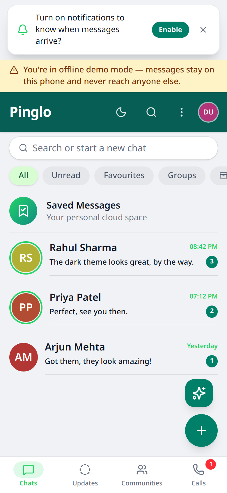
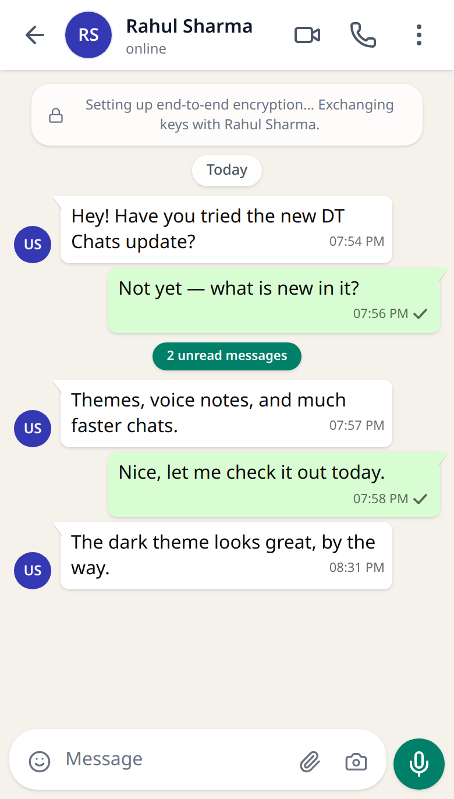
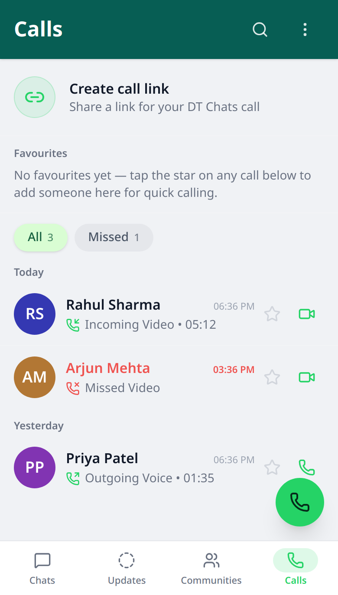
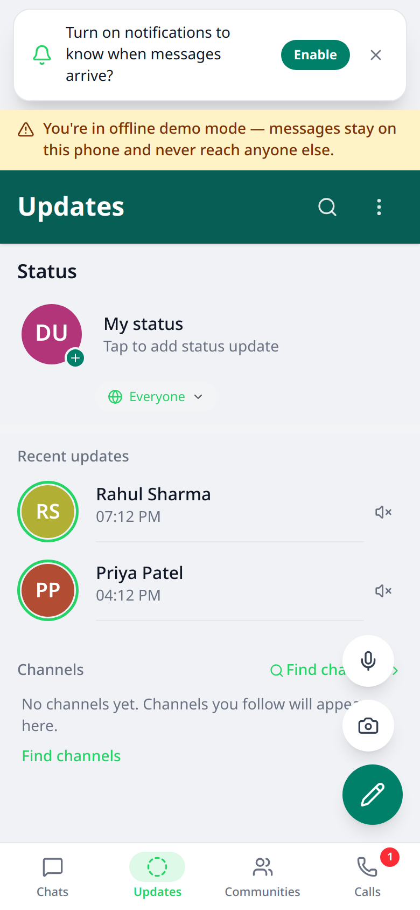
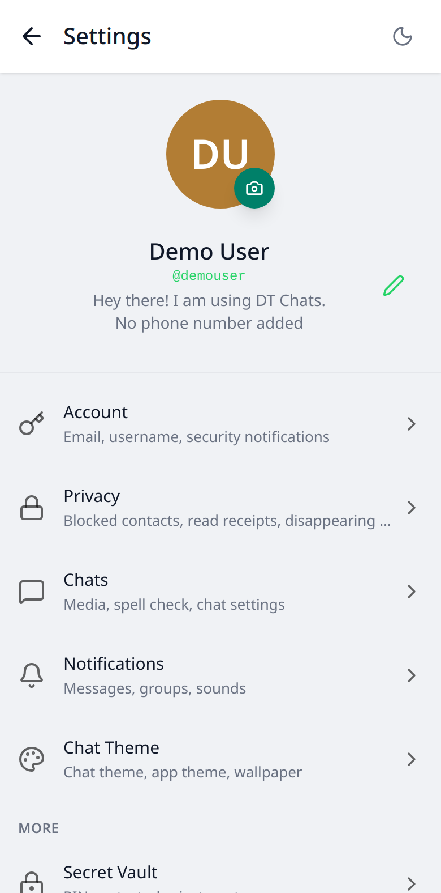
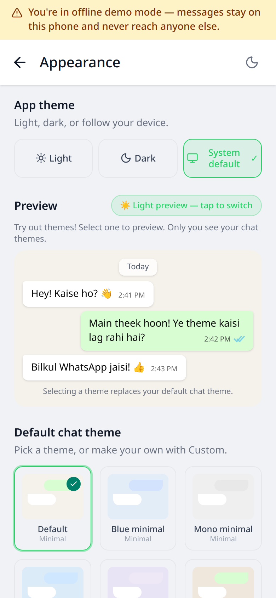
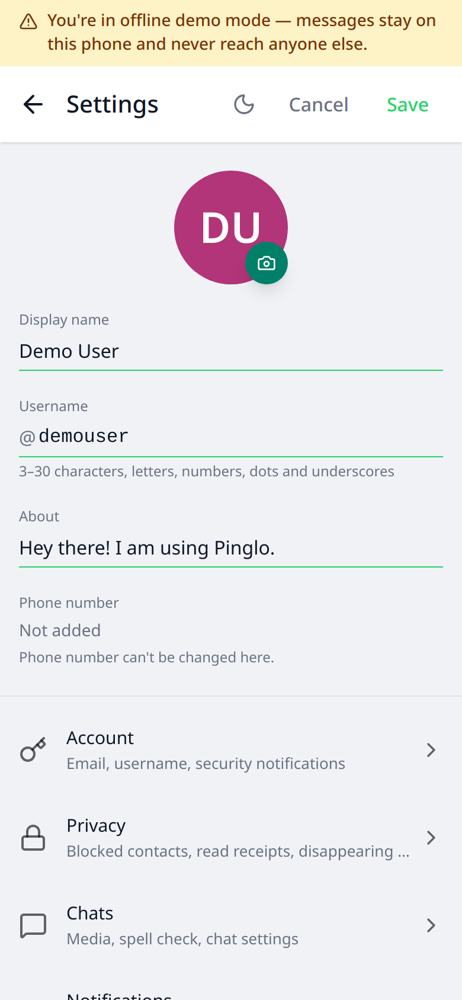

# Pinglo

Pinglo is a chat app that works a lot like WhatsApp. It runs on Android and on the web, and it is open source.

You can send messages one to one or in groups, make voice and video calls, post status updates, lock chats you want to keep private, and change how every chat looks.

It is still being built. The app works, but a few things still need a real backend or a second phone to test properly. The "Not finished yet" section below says plainly what is missing, so you know where things stand.

---

## Screenshots

| Chat list | Conversation | Calls |
| --- | --- | --- |
|  |  |  |

| Status | Settings | Theme picker |
| --- | --- | --- |
|  |  |  |



---

## What it can do

### Messaging

- One to one chats and group chats
- Messages arrive in real time, with live sync
- Typing indicators and read receipts (ticks)
- Reply to, edit, delete, pin, and star messages
- Emoji reactions: tap or long-press a message
- Polls with up to 6 options and live vote counts
- Scheduled messages
- View Once media: photos and videos that disappear after one view
- Search inside a chat
- Offline queue: messages you send without internet go out on their own once you are back online

### Media and voice notes

- Send photos, videos, documents, and voice notes (recorded with the real microphone)
- Voice notes with slide to cancel and lock to record
- Share media from other apps into Pinglo
- Camera, gallery, and file picker
- Emoji picker, stickers, and GIFs (GIFs need a free Giphy key, see `.env.example`)

### Voice and video calls

- One to one voice and video calls over WebRTC, peer to peer
- Call history: incoming, outgoing, and missed
- Shareable call links
- Mute, speaker, video on and off, and end call controls

### Status

- Post photo, video, and text status updates
- Status privacy: everyone, contacts, close friends, or only you
- A story viewer with progress bars, tap to move forward or back

### Privacy and locks

- **End-to-end encryption for one to one text messages.** Each chat gets its own AES-256-GCM key, exchanged with ECDH. Group text is also encrypted, with per-sender keys. Media files, polls, location messages, stickers, and message metadata are **not** encrypted yet.
- **Locked chats.** Hide a chat behind a PIN or fingerprint. Locked chats stay out of the chat list, search, notifications, and gallery. You open them by typing a secret code in the search bar.
- **App lock.** Lock the whole app with a PIN or fingerprint when you step away.
- **Secret vault.** A separate PIN-protected space.
- Block and unblock contacts.

### Themes

- 15 preset chat themes, plus a free custom theme where you pick your own colours
- Chat wallpaper with a brightness slider
- Light, dark, and system app themes
- A different wallpaper and theme per chat
- A WhatsApp-style look: deep green headers, green sent bubbles, blue ticks

### Saved messages and more

- **Saved Messages.** Your own private space at the top of the chat list, for every message type.
- Broadcast lists: send one message to many people at once
- Communities and channels
- Chat backup and restore, on your device
- **Dev AI.** A built-in AI assistant (Google Gemini) that answers questions and can generate images. It needs a free Gemini API key. It is optional, the app works fine without it.

---

## Not finished yet

Please do not expect everything below to work yet:

- **The backend does not enforce the rules yet.** Encryption, locked chats, and privacy rules are enforced in the app on your phone, not on the server. A server-side check still needs to be added before this app is safe for real users.
- **Group calls** are planned, not finished.
- **Push notifications when the app is closed** are not finished.
- **Two-phone testing is still needed** for calls, message delivery ticks, and encryption between two real devices.
- **Payments are not included**, and they are not planned.

---

## How it is built

| Part | Technology |
| --- | --- |
| App UI | React 19 + TypeScript + Vite |
| Styling | Tailwind CSS 4 |
| Android wrapper | Capacitor 6 |
| Auth | AWS Cognito User Pools |
| Data and real-time sync | AWS AppSync (GraphQL) + DynamoDB |
| Media storage | AWS S3 |
| Calls | WebRTC (PeerJS) + your own TURN server (coturn on EC2) |
| Encryption | WebCrypto (AES-256-GCM, ECDH) |
| AI assistant | Google Gemini (optional, free tier) |

---

## Run it yourself

### What you need

- Node.js 20 or newer
- npm (comes with Node.js)
- For Android: Android Studio with SDK Platform 34 and Java 17

### Run on the web

```bash
# 1. Install dependencies
npm install

# 2. Copy the example settings file and fill in your own values
cp .env.example .env

# 3. Start the dev server
npm run dev
```

Then open <http://localhost:3000> in your browser.

Without AWS values in `.env`, the app runs in **local mode**. It works for trying the UI, but messages and accounts stay on your device and are not shared with anyone else. See [docs/SETUP.md](docs/SETUP.md) to connect real AWS services.

### Build the web app

```bash
npm run build
```

### Build the Android APK

**Automatic (GitHub Actions):** push to the `main` branch and the "Build Android APK" workflow builds a debug APK for you. Download it from the workflow run page under Artifacts (`Pinglo-debug-apk`).

**On your own computer:**

```bash
npm run android
```

This builds the web app, syncs it into the Android project, and opens Android Studio. From Android Studio, build and run the app on an emulator or a real phone.

Other useful commands:

```bash
npm run lint        # type check + lint
npm run typecheck   # type check only
npm test            # run tests (Vitest)
```

---

## Settings

All settings live in one file: `.env` in the project root. Never commit your real `.env` to git, it holds your private keys.

1. Copy the template:
   ```bash
   cp .env.example .env
   ```
2. Fill in your values. Each key is explained in `.env.example`.
3. Full step-by-step AWS setup: [docs/SETUP.md](docs/SETUP.md).
4. How to use each feature: [docs/USAGE.md](docs/USAGE.md).

The app reads these settings at build time:

| Setting | What it is |
| --- | --- |
| `VITE_AWS_REGION` | Your AWS region, for example `ap-southeast-2` |
| `VITE_AWS_USER_POOL_ID` | Cognito User Pool ID |
| `VITE_AWS_USER_POOL_CLIENT_ID` | Cognito app client ID |
| `VITE_AWS_IDENTITY_POOL_ID` | Cognito Identity Pool ID (optional) |
| `VITE_AWS_S3_BUCKET` | S3 bucket name for media |
| `VITE_AWS_APPSYNC_ENDPOINT` | AppSync GraphQL endpoint URL |
| `VITE_AWS_APPSYNC_API_KEY` | AppSync API key |
| `VITE_GEMINI_API_KEY` | Google Gemini API key (for Dev AI, optional) |
| `GEMINI_API_KEY` | Same as above, a fallback key, read if `VITE_GEMINI_API_KEY` is empty |

---

## Project layout

```
src/
  App.tsx            App entry point and navigation
  aws/               AWS setup (Amplify, Cognito auth, S3, AppSync data layer)
  components/        Shared UI components
  screens/
    auth/            Login, sign up, welcome
    chat/            Chat screen (messages, reactions, polls, voice notes)
    chats/           Chat list
    calls/           Calls, call history, call links
    status/          Status (stories)
    communities/     Communities and channels
    settings/        Settings, app lock, themes, storage
    dev/             Dev AI assistant
    hidden/          Locked chats and PIN screens
    saved/           Saved Messages
    starred/         Starred messages
    broadcast/       Broadcast lists
    scheduled/       Scheduled messages
    vault/           Secret vault
  services/          App logic (calls, encryption, themes, locks, offline queue)
  types/             Shared TypeScript types
  utils/             Small helpers
android/             Capacitor Android project
docs/                Setup and usage guides
```

---

## Contributing

Contributions are welcome. Please keep it simple:

1. Fork the repo and create a branch from `main`.
2. Make one small change per pull request.
3. Run `npm run lint` and `npm test` before you open the pull request.
4. Do not commit `.env`, API keys, or any real credentials. Use placeholders only.
5. Do not add payment features, they are out of scope for this app.

If you find a security problem, please do not open a public issue. Contact the owner privately instead.

---

## Credits

Created and owned by hharshhtiwarii-dev.

---

## License

**Suggested license: MIT.** This has not been confirmed yet. The owner still needs to choose and confirm the final license. Until then, do not treat the code as MIT-licensed. There is no LICENSE file in the repo yet.
